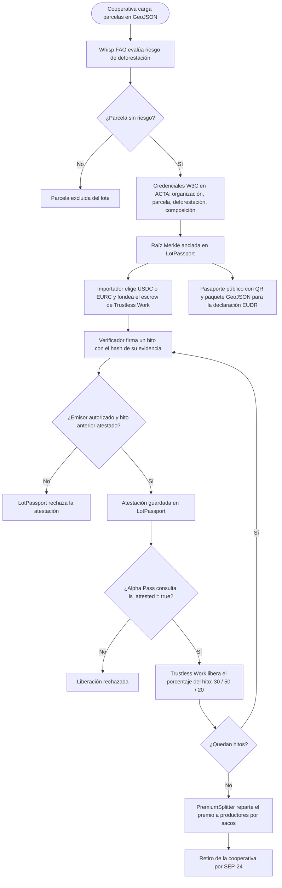
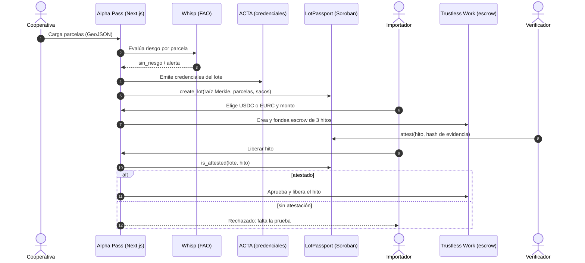
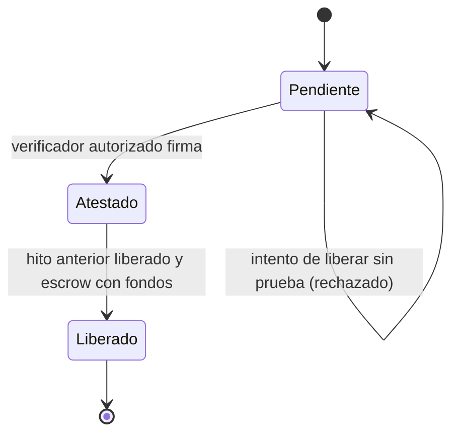

# Diagrama de flujo de Alpha Pass

Regla central: **el dinero no se mueve hasta que existe la prueba**. Cada hito del escrow se libera solo si `LotPassport` tiene la atestación de ese hito y el hito anterior ya se liberó.

## Flujo de punta a punta

## Quién hace qué

## Estados de un hito

## Límite honesto del MVP

Trustless Work no puede llamar a `LotPassport` desde su contrato. En el MVP, la cuenta de Alpha Pass es la aprobadora de hitos del escrow y solo aprueba si `is_attested` devuelve `true`. La verificación es pública y auditable en la cadena, pero la aprobación depende de esa cuenta de servicio. Una versión posterior puede usar un escrow propio que consulte `LotPassport` directamente.
